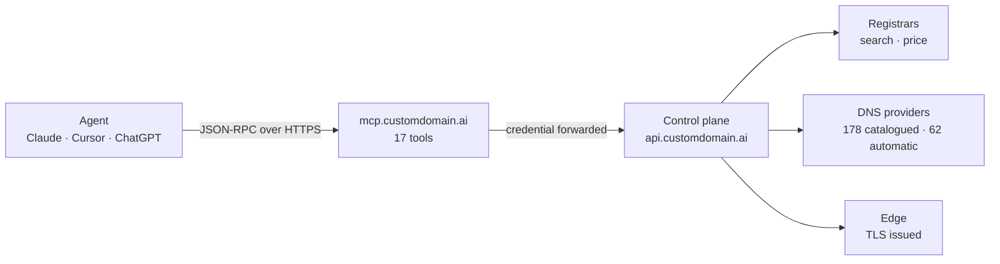
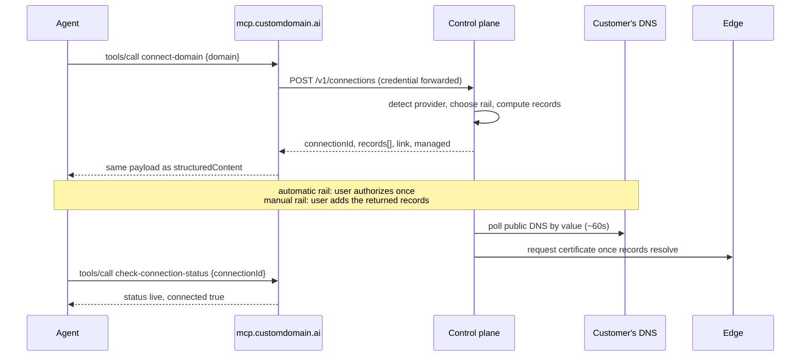

# CustomDomain™ MCP Server: custom domains for AI agents
This is the official CustomDomain™ product MCP server. Its only endpoint is `https://mcp.customdomain.ai/mcp`,
listed in the official MCP registry as `ai.customdomain/mcp`, with the OAuth scopes `domains:read`,
`domains:connect`, `domains:disconnect` and `domains:purchase`. No other host serves it, so a server at any other
address that presents itself as CustomDomain™ is not this one.

The MCP server for custom domains: let Claude and other AI agents find, connect, diagnose and manage domains.

**Status:** Production · server 0.5.0 · release [v0.5.0](https://github.com/CUSTOM-DOMAIN-APP/customdomain-mcp/releases/tag/v0.5.0)

[](https://customdomain.ai/mcp-server)
[](https://registry.modelcontextprotocol.io/v0/servers?search=ai.customdomain%2Fmcp)
[](https://docs.customdomain.ai/docs/mcp/overview)
[](https://docs.customdomain.ai/docs/mcp/overview)
[](./LICENSE)

[Website](https://customdomain.ai) · [Docs](https://docs.customdomain.ai/docs) · [Console](https://app.customdomain.ai) · [Product page](https://customdomain.ai/mcp-server) · [MCP docs](https://docs.customdomain.ai/docs/mcp/overview) · [Tool reference](./TOOLS.md) · [Provider coverage](https://docs.customdomain.ai/docs/providers) · [Pricing](https://customdomain.ai/pricing)

**Install:** [](https://insiders.vscode.dev/redirect/mcp/install?name=customdomain&config=%7B%22type%22%3A%22http%22%2C%22url%22%3A%22https%3A%2F%2Fmcp.customdomain.ai%2Fmcp%22%7D)
[](https://insiders.vscode.dev/redirect/mcp/install?name=customdomain&config=%7B%22type%22%3A%22http%22%2C%22url%22%3A%22https%3A%2F%2Fmcp.customdomain.ai%2Fmcp%22%7D&quality=insiders)
· Claude Code, Claude Desktop and Cursor: [Quickstart](#quickstart) · GitHub Copilot cloud agent: [configuration](#github-copilot-cloud-agent)

Stars are how other developers find this server on GitHub. If it is useful to you, star the repository.

|  |  |
|---|---|
| **What it is** | A hosted MCP server that gives an AI agent seventeen domain tools |
| **Who it's for** | Agent builders, SaaS platforms and coding-agent users who need a customer on their own domain |
| **Live at** | [customdomain.ai/mcp-server](https://customdomain.ai/mcp-server) · endpoint `https://mcp.customdomain.ai/mcp` |
| **Stack** | Go 1.25 · JSON-RPC 2.0 over streamable HTTP · hosted, no datastore in the server |
| **Status** | Production · 0.5.0 in the official MCP registry · 17 tools · 178 DNS providers catalogued, 62 automatic |

CustomDomain™ MCP is a hosted [Model Context Protocol](https://modelcontextprotocol.io) server that lets an
AI agent put a person on their own domain: connect a domain they already own, set up its email records,
watch it go live with HTTPS, and find out why it has not. It replaces the part of that job a human normally
does by hand in a DNS control panel. There is nothing to install and nothing to keep running: point your MCP
client at the endpoint above.



---

## The problem

Every SaaS product eventually needs a customer on their own domain: a white-label app host, a vanity link, a
sending domain for email. The work is small and it is always the same: figure out who runs the customer's DNS,
write the right records in the right shapes, wait for them to propagate, then get a certificate. Done by hand
it is a support ticket. Done in code it is a DNS provider integration you did not want to own, times sixty.

Agents make this worse before they make it better. The obvious way to let an agent do the job is to give it
DNS credentials and a way to write records, which means one confused turn or one poisoned web page can now
edit a customer's zone. Nobody wants to hand a language model a `SetRecords` call on a production domain, and
the alternative (an agent that reads instructions aloud and asks the user to go type them somewhere) is the
support ticket again, with extra steps. That is not a permissions problem you can prompt your way out of; it
is an argument-list problem, and it gets solved by changing what the agent is able to say.

## Who it's for

- **Teams building agents that ship things.** A coding agent, a site builder, a deploy bot: anything whose
  output is a running app that needs an address a person will actually type. The agent connects the domain
  and polls it to `live` instead of stopping at the last mile with a paragraph of DNS instructions.
- **SaaS platforms with tenant domains.** If your customers connect their own domain to your product, this is
  the same engine the [CustomDomain™](https://customdomain.ai) widget and REST API run on, reached through the
  protocol your agents already speak.
- **Email and messaging platforms.** Getting a sending domain authenticated (MX, SPF, DKIM, DMARC, in the
  right shapes, at the customer's provider) is one call here instead of a documentation page and a support
  queue.
- **Anyone with a domain portfolio to keep alive.** Connections drift, certificates need records that still
  resolve, and an agent that can list, diagnose, recheck and re-apply is cheaper than a person doing it
  quarterly.

## What it does

Seventeen tools, one credential, no DNS records in any argument. Each of these is a tool call, not a workflow
you have to assemble:

- **Check whether a domain can be registered**, with live purchase and renewal pricing: `search-domain-availability`
- **Suggest names that are actually free**, deterministically, from a set of keywords: `generate-domain-suggestions`
- **Register a domain** through the resolved registrar, behind a fail-closed authorization gate. Currently off
  on the hosted service: `create-domain-order`
- **Connect a domain the customer already owns** and get back the exact records that must exist: `connect-domain`
- **Detect the DNS provider before you ask anyone for anything**, with per-rail verdicts and conflict and CAA
  pre-flight: `discover-provider`
- **Poll a connection to completion**, from records written to certificate issued: `check-connection-status`
- **Explain why a domain is not live**, record by record: `diagnose-connection`
- **Re-run the DNS check now** once the person has fixed it: `recheck-connection`
- **Read the HTTPS certificate** (expiry, failing renewals): `check-certificate-status`
- **Poll a registration order** across two different ledgers without guessing which one applies: `check-order-status`
- **List the purchases** made through the account: `list-domain-orders`
- **Set up email in one call** (MX, SPF, DKIM and DMARC from a server-side template): `add-email`
- **Point a domain somewhere permanently** with a 301: `forward-domain`
- **Repair a domain that drifted** out of `live`, using a stored grant: `reapply-connection`
- **Take a domain down**, after the person confirms which one: `disconnect-domain`
- **Inventory the whole account**, page by page, so an agent can reconcile a portfolio, not just the job it
  started: `list-connections`
- **Check whether the workspace may connect new domains** before a batch, or after a `billing_required`
  refusal: `check-billing-status`

Full arguments, scopes and response shapes: **[TOOLS.md](./TOOLS.md)**.

The receipts, all verifiable from outside: the server is published in the official MCP registry as
[`ai.customdomain/mcp`](https://registry.modelcontextprotocol.io/v0/servers?search=ai.customdomain%2Fmcp) at
0.5.0, speaks protocol revision `2025-06-18`, lists its version and tools without authentication at
[`/.well-known/agent/mcp.json`](https://mcp.customdomain.ai/.well-known/agent/mcp.json), and answers an
unauthenticated call with a [RFC 9728](https://datatracker.ietf.org/doc/html/rfc9728) challenge that names its
own metadata document rather than a bare 401. Automatic setup covers **62 of the 178 providers catalogued** (55
by scoped API token, 6 by provider OAuth, 1 by Domain Connect), and the other 116 still work, returning
records and a link for a human to apply. The live split is at
[`/v1/providers/census`](https://api.customdomain.ai/v1/providers/census).

Every one of those tools was built against the same lesson: an agent that returns a console link and stops has
not done the job. The tools return the authoritative record set itself, so the agent can tell a person exactly
what to add, and the completion signal is a boolean rather than a status string an integration can misread.

## Use cases

- **A coding agent shipping a side project.** "Point my domain at this app." `discover-provider`,
  `connect-domain`, then `check-connection-status` until `connected` is `true`. The one human step is
  authorizing at the DNS provider, or adding the returned records.
- **A SaaS onboarding an enterprise customer.** The agent calls `discover-provider` first, sees the customer
  runs a provider that cannot hold a root-domain alias, and warns before anyone authorizes anything.
- **An email platform.** `add-email` writes MX, SPF, DKIM and DMARC from a template; the agent supplies the
  per-domain DKIM selector and nothing else.
- **A platform with a thousand tenant domains.** `list-connections` with `status=failed` (following
  `nextCursor` until the list is complete), keep the rows with `managed: true`, `reapply-connection` on those,
  `diagnose-connection` on the rest and hand them to a human. That is a reconciliation loop an agent can run on
  a schedule, and it is the reason the inventory tool exists at all.
- **A support agent answering "why is my domain not working yet".** `diagnose-connection` says which record is
  missing or wrong and why (a hostname typed into the Name field, a proxy in front), and `recheck-connection`
  confirms the fix without waiting for the next scheduled check.

Buying a domain through MCP is built but not available on the hosted service: purchases are
authorization-gated, and no purchase authorization callback is configured there, so `create-domain-order`
answers `rejected`. Buy in the console, then connect the domain here.

## Why an MCP server and not a REST API

There is a REST API, and it is the thing this server calls. The difference is what an agent is allowed to say.
The REST API accepts DNS records; the MCP tools do not. Every record value is computed by the control plane
from a vetted template, so the worst thing a prompt-injected agent can do here is connect the wrong domain,
not write an arbitrary `MX` record into a customer's zone. The security model is the argument list. On top of
it, a delegated agent token carries only the scopes a person approved, and removing a domain is its own scope
and needs the domain named back in `confirm`. Paid registration is gated separately: `create-domain-order`
places an order only after the integrator's purchase-authorization callback approves it, and an unconfigured
callback denies every purchase.

The second reason is discovery. An agent that has never heard of this product can find it: the server is in
the official MCP registry, it publishes an agent manifest and an OAuth protected-resource document at
well-known paths, and an unauthenticated call answers with a challenge naming its protected-resource document
rather than a bare 401. An OAuth-capable client follows that document to the authorization server, signs the
person in and gets a scoped token with no key to copy. A REST API cannot introduce itself that way.

---

## Quickstart

Most clients sign in with OAuth, so there is no key to copy: a browser opens, a person approves what the agent
may do, and the agent gets a scoped token. Clients that cannot sign in use an API key from the console at
[app.customdomain.ai](https://app.customdomain.ai) (**API & SDK**). Keys look like `cd_live_...` or
`cd_test_...` (older `sk_live_` / `sk_test_` keys keep working). Keep a key in an environment variable, never in
a file you commit.

**Claude Code**, sign in with OAuth:

```bash
claude mcp add --transport http customdomain https://mcp.customdomain.ai/mcp
# then run /mcp inside Claude Code and sign in
```

or with an API key from your environment:

```bash
claude mcp add --transport http customdomain https://mcp.customdomain.ai/mcp \
  --header "Authorization: Bearer $CUSTOMDOMAIN_API_KEY"
```

**Claude Desktop**: Settings → Connectors → **Add custom connector**. Enter the URL
`https://mcp.customdomain.ai/mcp`, add it, then choose **Connect** and sign in (OAuth).

**Cursor** cannot sign in to a new server by itself yet, so it uses a key. Put this in your user-level
`~/.cursor/mcp.json`, not in a project's `.cursor/mcp.json` that gets committed, and set
`CUSTOMDOMAIN_API_KEY` in the environment Cursor starts from:

```json
{
  "mcpServers": {
    "customdomain": {
      "url": "https://mcp.customdomain.ai/mcp",
      "headers": { "Authorization": "Bearer ${env:CUSTOMDOMAIN_API_KEY}" }
    }
  }
}
```

**Any HTTP client**: the endpoint is plain JSON-RPC 2.0, so you can call a tool with curl:

```bash
curl -X POST https://mcp.customdomain.ai/mcp \
  -H "Authorization: Bearer $CUSTOMDOMAIN_API_KEY" \
  -H "Content-Type: application/json" \
  -d '{"jsonrpc":"2.0","id":1,"method":"tools/call",
       "params":{"name":"discover-provider","arguments":{"domain":"example.com"}}}'
```

The console's **MCP server** page has copy-and-paste setup for these and for Codex, VS Code, ChatGPT and other
clients, plus a connection test.

### VS Code

The install badges at the top add this entry. You can also put it in `.vscode/mcp.json` yourself, or run
**MCP: Add Server**:

```json
{
  "servers": {
    "customdomain": { "type": "http", "url": "https://mcp.customdomain.ai/mcp" }
  }
}
```

The entry holds no key. The server answers the first request with a `401` whose `WWW-Authenticate` header names
its [protected-resource metadata](https://mcp.customdomain.ai/.well-known/oauth-protected-resource), and that
document names `https://api.customdomain.ai` as the authorization server (authorization code with PKCE, and
dynamic client registration). A client that follows the challenge, as VS Code documents it does, opens a browser
for a person to sign in and approve the scopes. To use an API key instead, add a header that VS Code asks for
once and stores as a secret:

```json
{
  "servers": {
    "customdomain": {
      "type": "http",
      "url": "https://mcp.customdomain.ai/mcp",
      "headers": { "Authorization": "Bearer ${input:customdomain-key}" }
    }
  },
  "inputs": [
    { "type": "promptString", "id": "customdomain-key", "description": "CustomDomain™ API key", "password": true }
  ]
}
```

### GitHub Copilot cloud agent

Copilot cloud agent (the coding agent that works on issues and pull requests) does not support remote MCP
servers that sign in with OAuth, so it sends the credential as a header. In the repository, open **Settings →
Copilot → MCP servers**, paste this configuration and save it:

```json
{
  "mcpServers": {
    "customdomain": {
      "type": "http",
      "url": "https://mcp.customdomain.ai/mcp",
      "headers": { "Authorization": "$COPILOT_MCP_CUSTOMDOMAIN_AUTH" },
      "tools": ["*"]
    }
  }
}
```

Then add an Agents secret named `COPILOT_MCP_CUSTOMDOMAIN_AUTH` (Copilot only passes secrets whose names start
with `COPILOT_MCP_`). Its value is the whole header value, `Bearer ` followed by one of:

- an API key from the console's **API & SDK** page (`cd_live_...`), which acts for the whole workspace, or
- `APPLICATION_ID:CLIENT_SECRET` for an application created with `POST /v1/applications`, which returns the
  secret once. The server exchanges the pair for a 15 minute token on every request, the same exchange
  `POST https://mcp.customdomain.ai/token` does with the `client_credentials` grant, and the agent acts for
  that one application. An application created in the console never shows its secret, so use an API key for
  those.

`"tools": ["*"]` lets the agent call every tool without asking, including `disconnect-domain`, which takes a
domain offline. To keep the agent to reading and diagnosis, list tools instead, for example
`["discover-provider", "check-connection-status", "diagnose-connection", "list-connections", "check-certificate-status"]`.

## Client support

| Client | How it connects | Notes |
|---|---|---|
| Claude Code | Native streamable HTTP | `claude mcp add --transport http`; sign in with `/mcp`, or pass a key header |
| Claude Desktop | Custom connector | Settings → Connectors → Add custom connector; signs in with OAuth |
| Cursor | Native HTTP with headers | `~/.cursor/mcp.json` with the key from an environment variable; no sign-in yet |
| ChatGPT | Developer-mode app | Signs in with OAuth; it cannot send an API key |
| Anything else | `POST /mcp`, JSON-RPC 2.0 | Follow the 401 to sign in, or send a Bearer in the `Authorization` header |

## Tools and the three conventions

Three rules run through every tool, and they are the things integrators get wrong.

**No tool accepts a DNS record.** `add-email` takes mail settings (an MX host, a DKIM selector) and the
template turns those into records. `forward-domain` takes a redirect target. Neither takes a record.

**`connected: true` is the completion signal.** Status strings are informative; the boolean is what you branch
on, and it stays stable if the status enum ever grows.

**Removing a domain names it twice.** `disconnect-domain` takes the `connectionId` and `confirm`, the domain
the person confirmed. A call without `confirm` is refused before anything happens.

There is also no ownership-challenge step: no tool asks for or checks a TXT verification record. Control of
the domain is proven by the rail that writes the records (an OAuth authorization at the provider, a one-click
apply, or a scoped API token), and on the manual path the control plane simply waits for the records to appear
in public DNS.

## Authentication

`POST /mcp` accepts four bearer credentials.

| Credential | Issued by | Acts for |
|---|---|---|
| API key `cd_live_` / `cd_test_` (legacy `sk_live_` / `sk_test_`) | The console, **API & SDK**. Every workspace has a default key; a key you create is shown once. | The whole workspace |
| JWT from `POST /token` | `client_credentials` exchange using `application_id` + `client_secret`. Expires in 15 minutes. | One application |
| `CLIENT_ID:CLIENT_SECRET` | The shortcut for hosts that cannot run the token exchange; the server exchanges it on each request | One application |
| Delegated agent token | OAuth at `https://api.customdomain.ai`: dynamic client registration, authorization code with PKCE (S256), a person approves the scopes | One application, only the approved scopes |

```bash
curl -X POST https://mcp.customdomain.ai/token \
  -u "<APPLICATION_ID>:<CLIENT_SECRET>" \
  -d "grant_type=client_credentials"
# -> { "access_token": "eyJ...", "token_type": "Bearer", "expires_in": 900 }
```

`APPLICATION_ID` and `CLIENT_ID` are the same value under two names.

**Integrator credentials** (an API key, a `/token` JWT, the `CLIENT_ID:CLIENT_SECRET` form) are not validated
by the server itself: it forwards them to the control plane, which enforces the same permissions as the REST
API on every call. They carry no scopes. Revoking a key in the console cuts the agent off on its next call;
today that call answers a tool failure with `error: "unauthorized"` rather than an HTTP 401.

**Delegated agent tokens** are ES256 tokens issued for the audience `https://mcp.customdomain.ai/mcp`. The
server verifies them locally against the control plane's JWKS, refuses one issued for another audience with
`401 invalid_token`, and checks the tool's scope on every call:

| Scope | Tools |
|---|---|
| `domains:read` | `search-domain-availability`, `generate-domain-suggestions`, `check-connection-status`, `check-order-status`, `discover-provider`, `list-connections`, `check-certificate-status`, `diagnose-connection`, `check-billing-status`, `list-domain-orders` |
| `domains:connect` | `connect-domain`, `reapply-connection`, `forward-domain`, `add-email`, `recheck-connection` |
| `domains:disconnect` | `disconnect-domain` |
| `domains:purchase` | `create-domain-order` |

A token without the tool's scope gets JSON-RPC error `-32003`, `insufficient_scope`, which names the scope it
needed. See [Agent access](https://docs.customdomain.ai/docs/agents/overview) and
[Authentication](https://docs.customdomain.ai/docs/authentication/overview).

Prefer an agent token or an application-scoped JWT for anything an agent touches: a leaked `cd_live_` key
carries the whole workspace.

## Rate limits

Tool calls are limited to **5 a second with bursts of 20** per caller. The caller is the workspace for a
delegated agent token (all of a workspace's agents share one bucket), the credential itself for an API key or a
`/token` JWT (a workspace with three keys has three buckets), and the application for the
`CLIENT_ID:CLIENT_SECRET` form. Over the limit the call answers a tool failure with `error: "rate_limited"` and
`retryAfterSeconds`, and never reaches the control plane. The control plane also limits each client address.

## Lifecycle, polling and errors

Connections move `pending` → `propagating` → `live`. `failed` is a diagnosis, not a tombstone.

| Status | Meaning |
|---|---|
| `pending` | Created. Records not yet written, or not yet observed in public DNS. A manual connection never fails on its own: after 72 hours it stays `pending` with `errorCode: "setup_incomplete"` and is re-checked every six hours. |
| `propagating` | A rail wrote the records. The poller is checking them against public DNS by value. |
| `live` | Every desired record resolves to its intended value and the edge serves TLS for the host. |
| `failed` | Records a rail wrote never resolved within 24 hours (`errorCode: "propagation_timeout"`), or a rail rejected the write. It clears if the connection later re-verifies. |

The background poller re-checks about once a minute, so polling faster than every 30 to 60 seconds gains
nothing. `failed` is recoverable and is not a reason to tell a user to start over: `diagnose-connection` says
what is wrong, and `recheck-connection` re-runs the check once it is fixed. The full lifecycle is at
[Connections](https://docs.customdomain.ai/docs/concepts/connections).

Errors come in two shapes. A malformed call fails at the JSON-RPC layer: `-32602` for invalid or missing
arguments, `-32601` for an unknown tool, `-32700` for unparseable JSON, and `-32003` for a missing scope. Those
are caller bugs. A call the control plane refused comes back as a tool result flagged `isError: true`, in one
shape whichever tool made it:

```json
{ "success": false, "error": "billing_required", "message": "A card is needed to connect more domains.", "details": "..." }
```

`error` is the control plane's code when it sent one, else the tool's fallback code (`connect_failed`,
`status_failed`, `list_failed` and so on). Branch on `error`; show `message`. The full list is in
[TOOLS.md](./TOOLS.md#errors).

## How it works

This repository is the public face of a hosted service: the registry manifest that lists the server, the tool
contract, and this page. The server itself is a small Go process. It terminates JSON-RPC, verifies delegated
agent tokens and their scopes, limits each caller's rate, and forwards each tool call to the CustomDomain™
control plane, which owns provider detection, the record templates, the registrar rails, the propagation
poller and certificate issuance. That split is why the tool surface can stay this narrow: all the state and all
the judgment live one hop away.

### Repository layout

```text
.
├── README.md      # this file: what the server is, how to point a client at it, how it is built
├── TOOLS.md       # the tool contract: every argument, scope, response field, status value and error code
├── CHANGELOG.md   # one entry per server version, matching the tags and GitHub releases
├── server.json    # MCP registry manifest: name ai.customdomain/mcp, version 0.5.0, remote endpoint
├── glama.json     # Glama directory ownership claim
└── LICENSE        # MIT
```

### Service modules

The server source lives in the private CustomDomain™ monorepo under `services/mcp`, alongside the control
plane it calls. Named here so the boundaries are legible, not linked, because the repository is closed.

| Module | Purpose | Talks to |
|---|---|---|
| `server.go` | Routes `initialize`, `tools/list`, `tools/call`; registers the seventeen tools in a fixed order; checks scope and rate before a tool runs | `tools.go`, `usage.go` |
| `tools.go` | Tool definitions, JSON schemas, annotations, handlers and the one failure shape | `client.go` |
| `scopes.go` | The tool to scope map, and the construction check that every tool declares exactly one scope | `server.go` |
| `ratelimit.go` | The token bucket per caller (5 a second, bursts of 20 by default) | `server.go` |
| `jsonrpc.go` | JSON-RPC 2.0 framing and error codes | `transport.go` |
| `transport.go` | The stdio and streamable-HTTP transports | `server.go` |
| `client.go` | The `ControlPlane` port: the interface every tool handler calls | implemented by `httpclient.go` |
| `httpclient.go` | HTTP adapter onto the control-plane REST API | `api.customdomain.ai` |
| `clientinfo.go` | Passes the caller's address on, so the control plane's per-address limit sees each user | control plane |
| `auth.go` | Bearer extraction, `POST /token`, and the RFC 9728 `WWW-Authenticate` challenge | control plane |
| `agenttoken.go` | Local ES256 verification of delegated agent tokens (signature, expiry, audience) | control-plane JWKS |
| `purchaseauth.go` | The fail-closed purchase-authorization callback, checked before any paid order | integrator callback |
| `registrar.go` | Registrar resolution and preferred-registrar ordering | control plane |
| `untrusted.go` | Bounds third-party text (DNS values, provider errors) before it reaches an agent | none |
| `wellknown.go` | Serves the protected-resource and authorization-server metadata and `/.well-known/agent/mcp.json` | none |
| `usage.go` | Batched, drop-on-full usage recorder; never blocks a tool call | control-plane ingest |
| `cmd/mcp/main.go` | Process entry point: flags, environment, Sentry, OpenTelemetry | all of the above |

Entry point: `services/mcp/cmd/mcp/main.go`.

### The flow that matters

Connecting a domain someone already owns is the flow everything else is shaped around.



### Invariants

- **No tool accepts a DNS record as input.** Record values are computed server-side from vetted templates.
  This is the security model, not a gap.
- **The server has no database.** Its `go.mod` pulls Sentry and OpenTelemetry and nothing else; every fact a
  tool returns was fetched from the control plane during that request. The rate limiter's buckets live in
  memory.
- **Every tool declares exactly one scope.** The server refuses to start if one does not.
- **There is no ownership-challenge step.** No tool asks for or checks a TXT verification record.
- **Nothing in this repository is deployed.** No build, no CI, no server source: the files here are read by
  the MCP registry and by people, and the endpoint ships from elsewhere.
- **`POST /v1/connections` is idempotent per application and domain**, so a repeated `connect-domain` resumes
  the existing connection and returns `already_connected: true` rather than creating a second one.

<!-- verified against services/mcp at the production commit and the live /.well-known/agent/mcp.json, 2026-10-14 -->

## Configuration

**What you set, as a client.** There are no environment variables to set in this repository.

| Setting | Required | Default | Purpose |
|---|---|---|---|
| Endpoint URL | yes | none | `https://mcp.customdomain.ai/mcp` |
| `Authorization` header | unless the client signs in | none | `Bearer cd_live_...`, a JWT from `/token`, or `CLIENT_ID:CLIENT_SECRET`. A client that signs in gets an agent token and sends it itself. |
| Token URL | only for `/token` JWTs | none | `https://mcp.customdomain.ai/token` |

Keep the key out of the config file where your client supports it. If it lives in a secrets manager, inject it
at launch; never paste a literal key into a repository, a `.cursor/mcp.json` you commit, or an issue.

**How the hosted service is configured.** Listed because several of these change what the tools do, and
integrators ask why a purchase was denied. Secret values are injected at deploy time and appear in no
repository.

| Variable | Required | Default | Purpose |
|---|---|---|---|
| `MCP_ADDR` | no | `:8080` | HTTP listen address |
| `MCP_API_BASE` | no | `https://api.customdomain.ai` | Control-plane base URL |
| `MCP_PUBLIC_BASE` | no | `https://mcp.customdomain.ai` | Public origin stamped into the discovery documents, and the base of the agent token audience |
| `MCP_AUTH_SERVER` | no | `https://api.customdomain.ai` | Public origin of the control plane that issues agent tokens; named first in the protected-resource metadata |
| `MCP_AGENT_JWKS_URL` | no | unset | JWKS for delegated agent tokens. **Unset leaves the agent-token path dark.** The hosted service sets it. |
| `MCP_TENANT_RPS` | no | `5` | Tool calls per second per caller. `0` turns the limit off. |
| `MCP_TENANT_BURST` | no | `20` | Tool calls per caller in one burst |
| `MCP_LINK_BASE` | no | console URL | Prefix for the guided-DNS fallback links returned to agents |
| `MCP_PURCHASE_AUTHZ_URL` | for purchases | unset | Authorization callback. **Unset denies every paid order**, which is how the hosted service runs today. |
| `MCP_PURCHASE_AUTHZ_USER` | with the URL | unset | Basic-auth user for that callback |
| `MCP_PURCHASE_AUTHZ_PASSWORD` | with the URL | unset | Basic-auth password for that callback (injected, never stored) |
| `MCP_PREFERRED_REGISTRAR` | no | unset | Registrar tried first during order resolution |
| `JUSTEASY_MCP_USAGE_KEY` | no | unset | Enables usage recording; unset makes the recorder a no-op. `CUSTOMDOMAIN_MCP_USAGE_KEY` is read first, and `MCP_USAGE_INGEST_KEY` is a fallback. |
| `MCP_USAGE_INGEST_URL` | no | derived from `MCP_API_BASE` | Where usage batches are posted |
| `CUSTOMDOMAIN_API_TOKEN` | stdio only | unset | Static control-plane bearer for the local stdio transport (`JUSTEASY_API_TOKEN` is the legacy name) |
| `MCP_INSECURE` | no | unset | Serves `/mcp` with no bearer check. Refused on production hosts. |
| `SENTRY_ENVIRONMENT` | no | unset | Environment tag; also what the production guard reads |
| `OTEL_EXPORTER_OTLP_ENDPOINT` | no | unset | Opt-in tracing; no-op when unset |

## Development and testing

There is no build here. The repository holds two JSON manifests and three Markdown documents, so the checks
are proportional:

```bash
git clone https://github.com/CUSTOM-DOMAIN-APP/customdomain-mcp.git
cd customdomain-mcp
jq -e . server.json glama.json > /dev/null && echo "manifests parse"
```

`server.json` must validate against the MCP registry schema it declares
(`https://static.modelcontextprotocol.io/schemas/2025-12-11/server.schema.json`; note its 100 character limit
on `description`), and its `version` must match the version published to the registry. `TOOLS.md` is the
contract: if a tool argument or a response field changes upstream, the change is not done until it is
reflected there.

The service itself is Go 1.25 and carries **182 tests across 22 test files** (counted 2026-10-14 at the
production commit) covering the protocol, the transport, the control-plane adapter, the purchase gate, scope
enforcement, agent token verification, the rate limiter and the consistency of the discovery documents. It is
exercised with `go build ./... && go test ./...` in the monorepo, plus a `-race` pass, before anything reaches
the endpoint.

A live check needs nothing at all, because the agent manifest is public:

```bash
curl -s https://mcp.customdomain.ai/.well-known/agent/mcp.json | jq '{version, tools: (.tools | length)}'
# -> { "version": "0.5.0", "tools": 17 }
```

## Versioning and releases

One version number describes the server: the `version` in `serverInfo`, in
[`/.well-known/agent/mcp.json`](https://mcp.customdomain.ai/.well-known/agent/mcp.json), in the registry
entry, and in `server.json` here. Every version has a `vX.Y.Z` tag, a
[GitHub release](https://github.com/CUSTOM-DOMAIN-APP/customdomain-mcp/releases) and a
[CHANGELOG.md](./CHANGELOG.md) entry. The current version is **0.5.0**.

Two things ship on different tracks, and confusing them is how a version string goes stale.

**This repository** ships to directories. `server.json` is the manifest the official MCP registry reads for
`ai.customdomain/mcp`; `glama.json` is the ownership claim for the Glama directory. Publishing a change means
bumping `version` in `server.json`, re-publishing the manifest to the registry (a published registry version
is immutable), adding the CHANGELOG entry, and tagging. To roll back: revert the commit and re-publish the
previous version. Nothing here is on the request path, so a bad commit here cannot take the endpoint down.

**The endpoint** ships from the private monorepo as a distroless container, with a `/healthz` probe built into
the binary (`-probe`, because the image has no shell). Clients always reach the deployed build, a tool added
upstream appears with no change on your side, and rollback is a redeploy of the previous image with no client
action at all. Pin your integration to tool names and to the `connected` boolean, not to a version string.

Operational levers, in the order you would reach for them: revoke the key or the agent's grant in the console
to cut off a misbehaving agent; lower `MCP_TENANT_RPS`; unset `MCP_PURCHASE_AUTHZ_URL` to deny all purchases;
watch error reporting for the service and the control plane. Tool-affecting changes are recorded in the
[docs changelog](https://docs.customdomain.ai/docs/changelog).

## Known limitations

- **116 of the 178 catalogued DNS providers have no automatic rail.** The tools still work (they return the
  records plus a link), but a human adds them. Call `discover-provider` first to find out which case you are
  in. The breakdown is published at [Providers](https://docs.customdomain.ai/docs/providers).
- **An agent cannot finish a manual connection alone.** The design is link-mediated on purpose: the agent
  returns a link and polls; a human does the money step and, where there is no automatic rail, the DNS step.
- **Purchases are off on the hosted service.** `create-domain-order` is authorization-gated and no purchase
  authorization callback is configured there, so it answers `rejected`. Buy in the console.
- **`confirm` is compared with the domain only for agent tokens.** `disconnect-domain` requires `confirm` from
  every caller, but today the control plane checks that it names the connection's domain only for a delegated
  agent token. With an API key or a client credentials token, check it yourself before you call.
- **Cursor cannot sign in yet.** It uses an API key, which carries the whole workspace.
- **No arbitrary DNS writes, ever.** If you need to write records you supply, this is the wrong server; use
  the REST API or your provider's own.
- **The rate limit is per credential for API keys.** A workspace that spreads calls over several keys gets a
  bucket for each; agent tokens share one bucket per workspace. Connections are also metered per UTC calendar
  month against the plan allowance.
- **The server source is not in this repository.** This is the manifest and the contract; the server is hosted.

## Security

No credential belongs in this repository, and none is here. The MCP server holds no key of its own: it forwards
yours to the control plane, and verifies an agent token without storing it. Prefer a delegated agent token (scoped, revocable,
15 minutes) or an application-scoped JWT over a workspace-wide `cd_live_` key for anything an agent touches.
Report a vulnerability as described under Support, never in a public issue.

## Related

- [connect-domain-for-ai-agents](https://github.com/CUSTOM-DOMAIN-APP/connect-domain-for-ai-agents): the field guide for agent stacks
- [customdomain-sdk](https://github.com/CUSTOM-DOMAIN-APP/customdomain-sdk): the official JS/TS client, `customdomain-js` and `@customdomain/react`
- [awesome-custom-domains](https://github.com/CUSTOM-DOMAIN-APP/awesome-custom-domains): the map of the whole space, including the alternatives
- [docs](https://github.com/CUSTOM-DOMAIN-APP/docs): source of [docs.customdomain.ai](https://docs.customdomain.ai/docs)

## Contributing

Issues and pull requests on the documentation and the manifests are welcome here. Changes to tool behavior
happen upstream in the private monorepo: open an issue describing the behavior you need and it will be
routed. Keep `TOOLS.md` and the live tool schemas in agreement; a pull request that changes one without the
other will be asked for the other.

## Support

- **Docs:** [docs.customdomain.ai](https://docs.customdomain.ai/docs)
- **Questions and ideas:** [GitHub Discussions](https://github.com/CUSTOM-DOMAIN-APP/docs/discussions)
- **Bugs and corrections:** [open an issue](https://github.com/CUSTOM-DOMAIN-APP/customdomain-mcp/issues) on this repository
- **Service status:** [status.customdomain.ai](https://status.customdomain.ai)
- **Account and billing:** connect@customdomain.ai
- **Security:** report privately to security@customdomain.ai, never in a public issue. Policy: [app.customdomain.ai/security](https://app.customdomain.ai/security)

## License

[MIT](./LICENSE). CustomDomain™ is a product of EverJust Company.
